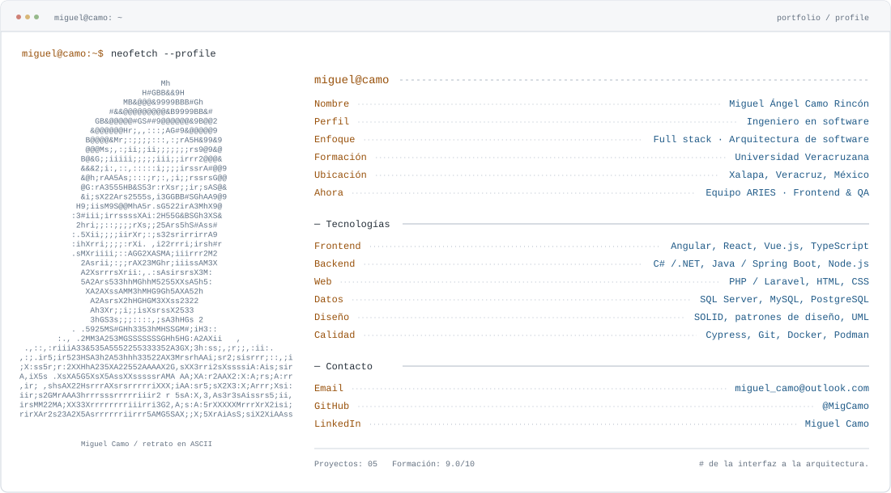

<!-- Generado con python scripts/build_profile.py. Editar profile.json para actualizar los datos. -->
<picture>
  <source media="(prefers-color-scheme: dark)" srcset="./assets/profile-dark.svg">
  
</picture>

[GitHub](https://github.com/MigCamo) · [LinkedIn](https://www.linkedin.com/in/miguel-%C3%A1ngel-camo-rinc%C3%B3n-722b492a1/) · [Email](mailto:miguel_camo@outlook.com) · [Portafolio y código](https://github.com/MigCamo/My-portfolio) · [CV actualizado (PDF)](https://github.com/MigCamo/My-portfolio/blob/main/assets/documents/miguel-camo-cv.pdf)

## `$ cat sobre_mí.md`

**Miguel Ángel Camo Rincón** · Ingeniería en software · Xalapa, Veracruz, México.

Soy ingeniero en software por la Universidad Veracruzana. Mi trabajo une el desarrollo de interfaces, la lógica de negocio y la integración de servicios. Me interesa entender el problema antes de elegir la tecnología.

Responsabilidades claras. Decisiones con contexto. Código que otro desarrollador pueda entender, probar y hacer evolucionar.

- **Desarrollo full stack:** Interfaces web, servicios backend y bases de datos conectados en una misma solución. De los requisitos a la implementación.
- **Arquitectura de software:** Análisis de mejoras, migración de funcionalidades y definición de estructuras mantenibles mediante patrones de diseño y arquitectura.
- **Calidad desde el inicio:** Pruebas automatizadas, seguimiento de errores y validación de correcciones para acompañar la evolución del producto.

## `$ less experiencia.log`

### EQUIPO ARIES · Desarrollador Frontend & QA

**Universidad Veracruzana** · Feb 2026 — Actualidad

Evolución del frontend con foco en arquitectura, mantenibilidad y calidad.

- Desarrollo e implementación de funcionalidades frontend para el sistema ARIES.
- Análisis y estimación de puntos de mejora para planificar la evolución técnica del proyecto.
- Participación en la migración del frontend y en la definición de una nueva arquitectura.
- Aplicación de buenas prácticas, patrones de diseño y de arquitectura de software para organizar responsabilidades y facilitar el mantenimiento.
- Automatización de pruebas con Cypress, documentación de errores y verificación de correcciones junto con el equipo.

**Stack / enfoque:** Frontend · Migración · Arquitectura · Cypress.

### SISTEMA DE EXÁMENES POR COMPETENCIAS · Junior Developer

**Universidad Veracruzana** · Ago 2025 — Dic 2025

Desarrollo backend de un sistema de gestión y reserva de exámenes por competencias.

- Implementación de servicios y controladores en C# y.NET, siguiendo buenas prácticas de arquitectura.
- Diseño y optimización de consultas y modelos de datos en MySQL.
- Colaboración en la integración con frontend y en la definición de requisitos técnicos.

**Stack / enfoque:** C# · .NET · MySQL · APIs.

### GESTIÓN DE PROYECTOS ACADÉMICOS · Junior Backend Developer

**Universidad Veracruzana** · Feb 2024 — Jun 2024

Implementación y optimización de la lógica de negocio para una plataforma académica.

- Desarrollo de autenticación y control de acceso con.NET Framework y SQL Server.
- Optimización de consultas para el almacenamiento y la recuperación de datos.

**Stack / enfoque:** .NET Framework · SQL Server · Autenticación.

## `$ ls -la ./proyectos`

| Proyecto | Qué construí | Tecnologías |
| --- | --- | --- |
| [TeamsHub](https://github.com/MigCamo/TeamsHubAPIGateway) | Un ecosistema para la gestión de proyectos académicos, con clientes web y de escritorio e integración de servicios. | C# / ASP.NET, Ocelot, API Gateway |
| [Monopoly: Magical Worlds](https://github.com/MigCamo/MonopolyClient) | Juego de escritorio multijugador con comunicación cliente-servidor, partidas en línea y mensajería entre jugadores. | C#, WPF, WCF |
| [Gestión de proyectos guiados](https://github.com/GustavoYuss/SGERYPG) | Organización y seguimiento de proyectos guiados y de experiencia recepcional en un entorno académico. | Java, Escritorio, Gestión de proyectos |
| [Italian Pizza](https://github.com/LuisAlonsoAndradeLopez/ItalianPizza) | Sistema para la operación de una pizzería: ventas, personal, inventario y flujo de caja. | C#, Entity Framework, Gestión de negocio |
| Plataforma de vacantes *(sin enlace público al código)* | Publicación de ofertas, gestión de postulaciones y seguimiento de candidatos en una aplicación web. | Laravel, Vue.js, PHP, Fortify |

TeamsHub: una mirada a la arquitectura

Un API Gateway centraliza las solicitudes y las dirige a los servicios correspondientes. Los clientes consumen una entrada común, separando la interfaz de la organización interna del backend.

[Explorar el cliente web](https://github.com/MigCamo/TeamsHubWebClient)

Monopoly: Magical Worlds: una mirada a la arquitectura

La interfaz WPF se comunica con el servidor mediante WCF. El servidor coordina la lógica de las partidas y el almacenamiento; el cliente permite crear o unirse a partidas de hasta cuatro jugadores.

[Explorar el servidor](https://github.com/MigCamo/MonopolyServer)

## `$ cat stack.conf`

| Área | Herramientas |
| --- | --- |
| Frontend | Angular, React, Vue.js, TypeScript, JavaScript, HTML & CSS |
| Backend y datos | C# /.NET, Java / Spring Boot, PHP / Laravel, Node.js, SQL Server, MySQL, PostgreSQL |
| Diseño, pruebas y entrega | Git, Docker, Podman, Cypress, Postman, UML, Scrum, ICONIX |

## `$ cat formación.md`

**Ingeniería en Software · Universidad Veracruzana**

Agosto 2021 — Enero 2026 · Promedio global de la carrera: **9.0/10**.

Incluido en las notas laudatorias de Ingeniería de Software de la UV, con promedio de 9.71 en el periodo agosto 2024 — enero 2025 y 9.38 en febrero — julio 2024.

- [Consultar nota 2024–2025](https://www.uv.mx/fei/files/2025/04/Lista-ISOF.pdf)
- [Consultar nota 2024](https://www.uv.mx/fei/files/2024/09/Lista-ISOF-v2-2.pdf)

## `$ ./contacto.sh`

¿Un proyecto, un reto técnico o una oportunidad? Escríbeme a [miguel_camo@outlook.com](mailto:miguel_camo@outlook.com).

[Mi trabajo en GitHub](https://github.com/MigCamo) · [LinkedIn](https://www.linkedin.com/in/miguel-%C3%A1ngel-camo-rinc%C3%B3n-722b492a1/) · [Descargar CV](https://github.com/MigCamo/My-portfolio/blob/main/assets/documents/miguel-camo-cv.pdf)
